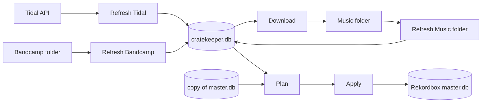

# Architecture

Cratekeeper is one Python package (`src/cratekeeper`) with a CLI and a local web
server, plus a React app (`frontend/`) that is built into the package. Domain words
are defined in [CONTEXT.md](../CONTEXT.md).

## Pipeline

| Step | Module | Writes |
| --- | --- | --- |
| Backup (database) | `backups.py` | `~/.cratekeeper/backups/` |
| Refresh Tidal | `tidal/refresh.py` | `cratekeeper.db` |
| Refresh Bandcamp | `bandcamp/refresh.py` | `cratekeeper.db` |
| Refresh Music folder | `music/refresh.py` | `cratekeeper.db` |
| Download | `download/runner.py` | audio files, `cratekeeper.db` |
| Plan | `rekordbox/planner.py` | nothing (works on a temp copy of the library) |
| Backup (full) | `backups.py` | `~/.cratekeeper/backups/` |
| Apply | `rekordbox/applier.py` | Rekordbox library, then `cratekeeper.db` |

`pipeline.py` runs the steps; every sync, apply and restore is stored as a row in
`runs` (the History screen). A sync run stores its Plan as JSON, so it can be
applied later from the UI or the CLI.

## Data model

The tables come from v1 (`tracks`, `playlists`, `playlist_tracks`, …) plus `runs`.
Per `playlist_tracks` row:

- `in_tidal` – the track is in the Tidal playlist now
- `in_bandcamp` – the file is in the playlist's Bandcamp folder now
- `in_local` – a Library track: a file in the playlist's Music folder sub-folder
  that matches no Tidal track (never set on a Tidal track)
- `in_rekordbox` – in the Rekordbox playlist after the last Apply

Rekordbox membership = rows with (`in_tidal` and a file) or `in_bandcamp` or
`in_local`. `playlists.in_tidal` says whether the playlist still exists on Tidal; a
playlist that no Source has any more is offered for deletion in the Plan.

`playlists.local_folder_path` fixes a playlist's Music folder sub-folder, so a
rename on Tidal (e.g. a new status emoji) keeps its files.

Migrations live in `db/migrations` and run when Cratekeeper starts.

## Matching

- **Files ↔ Tidal tracks** (`music/matching.py`): stored path, ISRC tag, Tidal URL
  tag, then file name ("<artists> - <title (version)>", unambiguous only).
- **Playlists ↔ Rekordbox playlists** (`rekordbox/planner.py`): stored ID, then the
  Rekordbox name inside the target folder, then unique name fallbacks.
- **Tracks ↔ Rekordbox collection** (`rekordbox/planner.py`, `rekordbox/content.py`):
  file path, stored content ID (if it points at one of the track's files), ISRC,
  then title + artist (unique only).

## Apply

Each Plan group (one playlist, or the deletion group) is applied and committed on
its own. On an error the group is rolled back and the library reopened, so nothing
leaks into the next group. Track removal is done by Cratekeeper itself because
pyrekordbox's `remove_from_playlist` commits on its own. Cratekeeper's database is
only updated after a group's commit succeeded.

Apply refuses while Rekordbox runs and when the library's fingerprint (USN and
latest playlist changes) differs from the Plan's. A Plan is also closed once an
Apply changed Rekordbox with it (even a partly failed one) and once a newer sync
ran; both need a new Plan. The deletion group is never selected by default.

## Jobs and the web server

`jobs.py` runs one job at a time per home folder (a lock file also stops a second
process). Jobs emit events (step, progress, log, finished/failed/cancelled). The
CLI prints them with Rich; the server streams them as Server-Sent Events.

`api/` is a FastAPI app bound to 127.0.0.1. Only Cratekeeper's own page may use it:
the Host header must match, and changing requests need the `X-Cratekeeper: 1`
header and a matching Origin. The contract is exported to `frontend/openapi.json`
(`scripts/export_openapi.py`) and the UI generates its types from it.

## Tests

`pytest` runs with `HOME` and `CRATEKEEPER_HOME` pointing at temp folders and with
network access blocked. Rekordbox tests use a real, unencrypted library built from
pyrekordbox's tables (`tests/conftest.py`), so pyrekordbox's real behaviour is
tested, not a mock.
